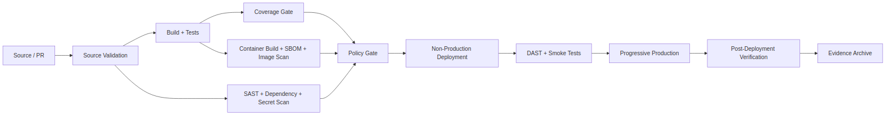

# NovaPay Zero-Downtime CI/CD Pipeline

## Overview

This project implements a multi-stage DevOps and Cloud Engineering CI/CD pipeline for
**NovaPay Digital Bank** — a fictional RBI-licensed digital bank moving from manual SSH
deployments to an automated, compliance-gated delivery pipeline.

The pipeline validates source code, tests application quality, performs security scanning,
builds and scans a container image, validates deployment policies, promotes through environments,
performs deployment verification, and archives evidence — with every gate mapped to a specific
RBI Master Direction section or PCI-DSS v4.0 requirement.

The pipeline is implemented using **GitHub Actions** and is triggered on pushes and pull requests
to the `main` branch.

## Key deliverables at a glance

| Deliverable | Location |
|---|---|
| Pipeline architecture + diagram | `docs/01-pipeline-architecture/` |
| Blue-green & canary deployment strategy + diagrams | `docs/02-deployment-strategies/` |
| RBI Master Direction / PCI-DSS v4.0 compliance gate mapping | `docs/03-compliance-gates/` |
| 5-phase expand-contract database migration + compatibility matrix | `docs/04-database-migration/` |
| Environment promotion workflow | `docs/05-environment-promotion/` |
| Rollback specification (3 trigger categories) + decision-flow diagram | `docs/06-rollback-specification/` |
| Deployment runbook & incident playbook | `runbooks/` |
| Observability & DORA metrics | `docs/08-observability/` |
| Six policy-as-code gates (Rego/Conftest) | `pipeline/policies/` |
| Helm chart | `pipeline/helm/novapay/` |
| Terraform (Kubernetes namespace/config) | `pipeline/terraform/` |
| Rollback script | `pipeline/scripts/rollback.sh` |
| Deliberate error findings (3, with textual evidence) | `ERRATA.md` |
| TRC approval presentation | `evidence/trc-presentation.pdf` |
| Honest status of simulated vs. live pipeline stages | `evidence/self-assessment.md` |
| Reflections | `evidence/reflections.md` |
| Pipeline run screenshots | `evidence/screenshots/` |

---

## CI/CD Pipeline Architecture



The actual pipeline flow is:

```text
Git Push / Pull Request
        │
        ▼
┌─────────────────────────┐
│    Source Validation    │
└────────────┬────────────┘
             │
             ▼
┌─────────────────────────┐
│ Test and Coverage Gate  │
└────────────┬────────────┘
             │
             ├──────────────────────────┐
             │                          │
             ▼                          ▼
┌──────────────────┐          ┌──────────────────────┐
│ Secret Scanning  │          │ SAST and Code Quality│
└────────┬─────────┘          └──────────┬───────────┘
         │                               │
         │        ┌──────────────────────┘
         │        │
         ▼        ▼
   ┌──────────────────────────┐
   │ Dependency Security Scan │
   └────────────┬─────────────┘
                │
                ▼
┌──────────────────────────────────┐
│ Container Build and Security     │
│                                  │
│ • Build application JAR          │
│ • Build Docker image             │
│ • Generate SBOM                  │
│ • Scan container image           │
└───────────────┬──────────────────┘
                │
                ▼
┌──────────────────────────────────┐
│ Policy and Compliance Validation │
│                                  │
│ • Helm template rendering        │
│ • 6 Rego policies via Conftest   │
│ • RBI / PCI-DSS gate mapping     │
└───────────────┬──────────────────┘
                │
                ▼
┌──────────────────────────────────┐
│ Deploy to Non-Production          │
└───────────────┬──────────────────┘
                │
                ▼
┌──────────────────────────────────┐
│ DAST and Smoke Tests              │
└───────────────┬──────────────────┘
                │
                ▼
┌──────────────────────────────────┐
│ Progressive Production Deployment │
│ (main branch only)                │
└───────────────┬──────────────────┘
                │
                ▼
┌──────────────────────────────────┐
│ Post-Deployment Verification      │
└───────────────┬──────────────────┘
                │
                ▼
┌──────────────────────────────────┐
│ Evidence Archival                 │
└──────────────────────────────────┘
```

The workflow definition lives at `.github/workflows/ci-pipeline.yml`.

---

## What's real vs. simulated in this repository

This project is transparent about which stages execute against real infrastructure in CI and
which are documented/simulated because they require infrastructure outside the scope of this
submission (a live Kubernetes cluster, a reachable DAST target, a service mesh for weighted
traffic shifting). The full breakdown is in `evidence/self-assessment.md`, and the underlying
limitations are explained in `ERRATA.md`.

**Runs for real in CI:** source validation, secret scanning (Gitleaks), unit tests + JaCoCo
coverage gate, SAST (Semgrep), dependency scanning (Trivy), Docker image build + SBOM generation
+ image scan, Helm template rendering + 6 Rego policy checks (Conftest).

**Simulated / documented only (see `ERRATA.md`):** non-production deployment, smoke tests, DAST
execution, progressive/canary production traffic shifting, and post-deployment verification.
These stages are represented as validation steps in the workflow and fully specified in `docs/`,
but do not run against a live cluster in this repository.

---

## Repository structure

```text
.
├── README.md
├── ERRATA.md
├── Dockerfile
├── app/                          # Java 21 / Spring Boot application + tests
│   ├── build.gradle
│   ├── settings.gradle
│   └── src/
├── docs/
│   ├── 01-pipeline-architecture/
│   ├── 02-deployment-strategies/
│   ├── 03-compliance-gates/
│   ├── 04-database-migration/
│   ├── 05-environment-promotion/
│   ├── 06-rollback-specification/
│   ├── 07-runbook-playbook/
│   └── 08-observability/
├── pipeline/
│   ├── helm/novapay/
│   ├── policies/                 # 6 Rego policies
│   ├── scripts/rollback.sh
│   └── terraform/
├── runbooks/
│   ├── deployment-runbook.md
│   └── incident-playbook.md
├── dashboards/
│   ├── grafana/
│   └── mockups/
├── evidence/
│   ├── trc-presentation.pdf
│   ├── self-assessment.md
│   ├── reflections.md
│   ├── screenshots/
│   └── test-results/
└── .github/workflows/ci-pipeline.yml
```

---

## Tools used

| Category | Tool |
|---|---|
| CI/CD engine | GitHub Actions |
| Language / build | Java 21, Gradle 8.8 |
| Secret scanning | Gitleaks |
| SAST | Semgrep |
| Dependency & container scanning | Trivy |
| SBOM generation | Anchore SBOM Action |
| Policy-as-code | OPA / Conftest (Rego) |
| Packaging | Helm |
| Infrastructure as Code | Terraform |
| Diagramming | Mermaid |

---

## Getting started locally

```bash
# Build and test the application
cd app
gradle clean build test jacocoTestReport --no-daemon

# Render and validate Kubernetes manifests
helm template novapay pipeline/helm/novapay > rendered-manifests.yaml
conftest test rendered-manifests.yaml --policy pipeline/policies

# Build the container image
docker build -t novapay:local .
```

## Notes on this submission

- All three deliberate technical errors planted in the assessment document have been identified
  with supporting evidence — see `ERRATA.md`.
- The Technology Risk Committee approval presentation is included at
  `evidence/trc-presentation.pdf`.
- `evidence/self-assessment.md` distinguishes "Completed" (runs for real in CI) from "Simulated"
  (documented and gated in the workflow, but requires infrastructure not present in this repo)
  rather than marking every stage as complete.
