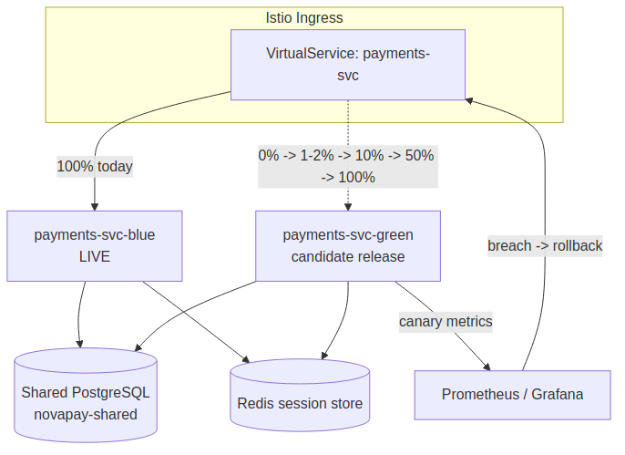
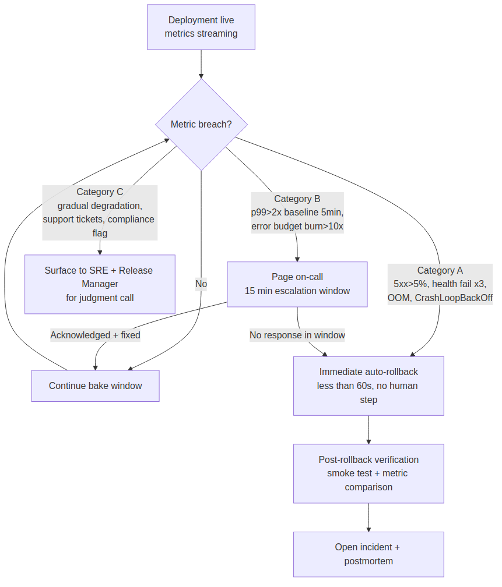

# Deliverable 2 — Blue-Green and Canary Deployment Strategy

## Objective
<<<<<<< HEAD
NovaPay requires a deployment design that minimizes customer disruption and provides a fast return to a known-good release. The strategy combines blue-green deployment for deterministic environment switching with a phased canary rollout for risk-controlled exposure.
=======
NovaPay requires a deployment design that minimizes customer disruption and provides a fast
return to a known-good release. The strategy combines blue-green deployment for deterministic
environment switching with a phased canary rollout for risk-controlled exposure.

## Architecture diagram

>>>>>>> 6c5a403 (update in project)

## Blue-Green topology
Two production-compatible environments are maintained:

- **Blue**: currently serving stable traffic.
- **Green**: receives the candidate release while isolated from customer traffic.
<<<<<<< HEAD
- **Traffic layer**: an Istio VirtualService or equivalent routing component controls which environment receives production traffic.
- **Shared services**: database and Redis-backed session state must remain compatible with both application versions during the transition.

### Five-step traffic switching protocol
1. Deploy the candidate version to the inactive environment.
2. Wait for startup, liveness and readiness checks to succeed.
3. Execute smoke tests and compatibility checks against the inactive environment.
4. Drain long-running requests from the active environment and switch traffic to the verified candidate.
5. Observe error rate, latency, saturation and payment success metrics while retaining the previous environment as the rollback target.

If a blocking metric is breached, traffic is returned to the previous stable environment.

## Canary rollout
A canary rollout limits initial customer exposure and promotes only when each observation period remains healthy.

| Phase | Traffic | Minimum checks |
|---|---:|---|
| 1 | 1% | readiness, smoke tests, error rate |
| 2 | 10% | baseline latency and error comparison |
| 3 | 50% | sustained saturation and downstream health |
| 4 | 100% | final production verification |

### Suggested promotion thresholds
- HTTP 5xx rate: stop and investigate when the canary materially exceeds the approved baseline; immediate rollback for a severe sustained breach.
- p95/p99 latency: halt promotion when regression exceeds the service SLO or agreed baseline tolerance.
- Readiness: all required replicas must be ready before the next phase.
- Payment success: no statistically meaningful degradation against the control population.
- Resource saturation: CPU, memory, connection pool and downstream dependency saturation must remain within operating limits.

## Statistical comparison
For a mature implementation, compare control and canary latency samples using Welch's t-test and compare error proportions using a proportion/chi-squared approach where sample size assumptions are satisfied. Statistical output supports a decision; it does not replace SLO and safety gates.

## Session and transaction safety
Session state should be externalized to a distributed store such as Redis so that traffic can move without depending on pod-local session memory. Long-running payment operations must support graceful shutdown and connection draining. New pods receive traffic only after readiness succeeds; terminating pods stop receiving new requests before their configured grace period expires.

## Rollback guarantee
The previous stable environment or stable ReplicaSet remains available until post-deployment verification succeeds. Database changes follow the expand-contract strategy described in Deliverable 4 so an application rollback is not blocked by an incompatible schema.
=======
- **Traffic layer**: an Istio VirtualService or equivalent routing component controls which
  environment receives production traffic.
- **Shared services**: database and Redis-backed session state must remain compatible with both
  application versions during the transition (see `docs/04-database-migration/` for how schema
  compatibility is guaranteed across the switch).

### Five-step traffic switching protocol
1. Deploy the candidate version to the inactive environment.
2. Wait for startup, liveness and readiness checks to succeed (minimum 30s stable across all
   replicas before proceeding).
3. Execute smoke tests and compatibility checks against the inactive environment (0% live
   traffic).
4. Drain long-running requests from the active environment and switch traffic to the verified
   candidate. Connection draining window: **30–60 seconds for standard HTTP requests**, extended
   to **up to 5 minutes for in-flight payment settlement jobs** via a `preStop` hook that flips a
   readiness flag before the pod stops accepting new work.
5. Observe error rate, latency, saturation and payment success metrics while retaining the
   previous environment scaled-down-but-warm as the rollback target (not deleted).

If a blocking metric is breached, traffic is returned to the previous stable environment via a
single atomic weight update — this does not require redeploying anything.

## Canary rollout

| Phase | Traffic | Duration | Promotion criteria (numeric) | Auto action |
|---|---:|---|---|---|
| 1 — Canary | 1–2% | 15 min | Error rate < 0.1%, p99 latency < 200ms | Proceed / auto-rollback |
| 2 — Early Adopter | 5–10% | 30 min | Error rate < 0.05%, no critical alerts | Proceed / auto-rollback |
| 3 — Expansion | 25–50% | 60 min | All SLOs met, no degradation vs. 7-day baseline | Proceed to full rollout |
| 4 — Full Rollout | 100% | 24h bake | Complete SLO compliance sustained for 24h | Mark deployment stable |

### Automated rollback trigger thresholds

| Category | Response window | Trigger conditions |
|---|---|---|
| **A — Immediate** | < 60 seconds, zero human intervention | HTTP 5xx rate > 5% sustained 60s; 3 consecutive health-check failures; OOM kill; CrashLoopBackOff; DB connection pool exhaustion |
| **B — Escalated** | < 15 minutes, alert on-call first | p99 latency > 2× the 7-day rolling baseline for 5 min; error-budget burn rate > 10× normal for 10 min; transaction success rate drops > 2% below baseline; CPU > 90% or memory > 85% sustained 5 min |
| **C — Manual decision** | Surfaced, not auto-acted | Gradual degradation below hard thresholds; customer-support ticket spikes; retroactive compliance failure; correlated downstream dependency errors |

Category A triggers page nobody — the mesh reverts traffic weight automatically. Category B pages
on-call and auto-rolls-back if unacknowledged within the escalation window. Category C requires
an SRE/Release Manager judgment call.

## Statistical comparison
For a mature implementation, compare control and canary latency samples using **Welch's t-test**
and compare error proportions using a **chi-squared proportion test**, requiring a **95%
confidence interval** before auto-promoting to the next canary phase. Statistical output supports
the promotion decision; it does not replace the hard SLO and safety-threshold gates above.

## Session and transaction safety
Session state is externalized to a distributed store (Redis) so traffic can move without
depending on pod-local session memory. Long-running payment operations support graceful shutdown
and connection draining as described in the five-step protocol above. New pods receive traffic
only after readiness succeeds; terminating pods stop receiving new requests before their
configured grace period (`terminationGracePeriodSeconds: 60`) expires.

## Rollback decision flow

## Rollback guarantee
The previous stable environment (blue-green) or the prior stable ReplicaSet (canary) remains
available until post-deployment verification succeeds — nothing is torn down until the new
version has proven itself over the full bake window. Database changes follow the expand-contract
strategy described in `docs/04-database-migration/database-migration.md`, so an application-level
rollback is never blocked by an incompatible schema: every intermediate schema state supports
both the outgoing and incoming application version.

## Independent rollback path (Cloudflare lesson applied — see `ERRATA.md` Error 2)
The July 2019 Cloudflare outage took 27 minutes to resolve specifically because the rollback
mechanism itself depended on the same control plane that the faulty change had degraded. NovaPay's
rollback path is deliberately **independent of the primary deployment path**: the traffic-weight
revert operates at the Istio/mesh layer, which remains reachable even if application pods are
crash-looping or the CI/CD control plane is degraded.
>>>>>>> 6c5a403 (update in project)
