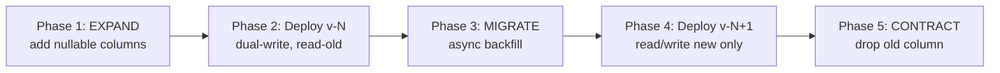

<<<<<<< HEAD
# Deliverable 4 — Zero-Downtime Database Migration

## Strategy: expand → migrate → switch → contract

### 1. Expand
Add backward-compatible structures without removing existing columns or behavior. Both App V(N-1) and App V(N) must continue to operate.

### 2. Migrate/backfill
Populate new structures in throttled batches. Record progress and stop or reduce throughput when database latency, locks or replication lag exceed operational limits.

### 3. Switch
Release application logic that can read/write the new structure. Prefer dual-read/dual-write or a controlled feature switch only while compatibility is required.

### 4. Contract
Remove old structures only after all supported application versions and rollback windows no longer depend on them.

## Compatibility matrix

| Schema state | App V(N-1) | App V(N) |
|---|---|---|
| Before expand | supported | not yet deployed |
| Expanded | supported | supported |
| During migrate | supported | supported |
| Switched | compatibility-dependent | supported |
| Contracted | retired | supported |

## Governance
- DBA or designated database owner approves production migrations.
- Migration review checks locking behavior, index creation, rollback, backup and application compatibility.
- Migration execution records operator, timestamp, version and result.
- Destructive changes require a separate change window after the compatibility period.

## Backfill
Use ordered batches with checkpoints. Avoid a single transaction for large tables. Throttle between batches and make the job restartable and idempotent where possible.

## Rollback
Application rollback should remain possible through the expand and migrate phases. If a migration itself must be reversed, use a separately reviewed compensating migration rather than assuming every DDL operation is safely reversible.
=======
# Deliverable 4 — Zero-Downtime Database Migration Strategy

## Objective
Database migrations are the highest-risk component of any banking deployment. NovaPay uses the
**expand-contract pattern** for every schema change touching a live, high-throughput table, so
that no phase requires a table-level lock or a maintenance window.

## Worked example
Splitting `full_name` into `first_name` / `last_name` on `customer_profiles` (assume 100M+ rows,
PostgreSQL 16), executed across 5 independently deployable phases.



### Phase 1 — Expand (backward-compatible, online, no lock)
```sql
-- V3.0__expand_split_full_name.sql
ALTER TABLE customer_profiles
  ADD COLUMN first_name VARCHAR(100),
  ADD COLUMN last_name  VARCHAR(100);

-- Index built CONCURRENTLY so it never blocks writers
CREATE INDEX CONCURRENTLY idx_customer_last_name ON customer_profiles (last_name);

INSERT INTO schema_audit_log (migration_id, description, executed_by, phase)
VALUES ('V3.0', 'Expand: add first_name/last_name', current_user, 'EXPAND');
```
App `V(N-1)` is completely unaware of the new columns — the schema is backward compatible. This
phase is trivially rolled back by dropping the two new (empty) columns if anything looks wrong.

### Phase 2 — Deploy v(N): dual-write, read-old
Application code writes `full_name` (legacy, still authoritative for reads) **and**
derives/writes `first_name`/`last_name` on every insert/update. Behaviour for existing consumers
is unchanged. This is a normal, reversible deploy through the canary pipeline
(`docs/02-deployment-strategies/`).

### Phase 3 — Migrate: asynchronous, throttled backfill for historical rows
```sql
-- V3.1__migrate_backfill_names.sql — idempotent, throttled batch job
DO $$
DECLARE
  batch_size INT := 2000;
  affected   INT;
BEGIN
  LOOP
    UPDATE customer_profiles
    SET first_name = split_part(full_name, ' ', 1),
        last_name  = substr(full_name, length(split_part(full_name,' ',1)) + 2)
    WHERE first_name IS NULL
      AND id IN (
        SELECT id FROM customer_profiles
        WHERE first_name IS NULL
        LIMIT batch_size
        FOR UPDATE SKIP LOCKED
      );
    GET DIAGNOSTICS affected = ROW_COUNT;
    EXIT WHEN affected = 0;
    PERFORM pg_sleep(0.15);  -- throttle to cap replication lag & CPU impact
  END LOOP;
END $$;
```
**Abort criteria:** if replication lag or query p99 latency degrades more than 20% during the
run, the job auto-aborts and pages the DBA. This runs as a scheduled, monitored batch job — never
a manual 2 AM maintenance-window operation. It is retryable: a failed run resumes automatically
because already-migrated rows are skipped by the `WHERE first_name IS NULL` predicate.

### Phase 4 — Deploy v(N+1): read/write exclusively on new columns
Reads and writes move to `first_name`/`last_name` only; `full_name` is left populated but frozen.
This deploy is gated on a pre-deploy verification query confirming zero rows remain with
`first_name IS NULL AND full_name IS NOT NULL`. Rollback path: revert to the Phase-2 build, which
still reads from the (still-populated, still-correct) `full_name` column.

### Phase 5 — Contract (irreversible — separate deployment, separate approval gate)
```sql
-- V3.2__contract_drop_full_name.sql
-- Forward-only. Requires: (a) all services confirmed on v(N+1) for 7+ days,
-- (b) DBA + Release Manager dual sign-off, (c) full logical backup taken first.
ALTER TABLE customer_profiles DROP COLUMN full_name;

INSERT INTO schema_audit_log (migration_id, description, executed_by, phase)
VALUES ('V3.2', 'Contract: drop legacy full_name column', current_user, 'CONTRACT');
```
This is the only phase without a same-pipeline auto-rollback. It requires its own change-approval
gate (RBI §4.2) and only runs after an extended validation window.

## Version compatibility matrix

| App version | Reads from | Writes to | Compatible schema state |
|---|---|---|---|
| V(N-1) — pre-migration | `full_name` | `full_name` | Phase 1 (post-expand) |
| V(N) — dual-write | `full_name` | `full_name` + `first_name`/`last_name` | Phase 1–3 |
| V(N+1) — cutover | `first_name`/`last_name` | `first_name`/`last_name` | Phase 3 complete → Phase 5 |

At every point in this sequence, at least two adjacent app versions can run against the current
schema simultaneously — which is exactly what makes the blue-green traffic switch in Deliverable
2 safe: an application-level rollback from V(N+1) to V(N) never hits a missing-column error.

## Migration governance
- **Tooling:** `pgroll` for PostgreSQL online schema migration (avoids table-level locks); Flyway
  for versioned, ordered migration script execution.
- **Approval gate:** every migration script under `database/migrations/` requires DBA team
  review via `CODEOWNERS` before merge; the Contract phase additionally requires a Change
  Advisory Board sign-off.
- **Audit trail:** every phase writes a row to `schema_audit_log` (migration ID, description,
  executor, phase) — satisfying RBI §6.1 comprehensive audit trail requirements.
>>>>>>> 6c5a403 (update in project)
